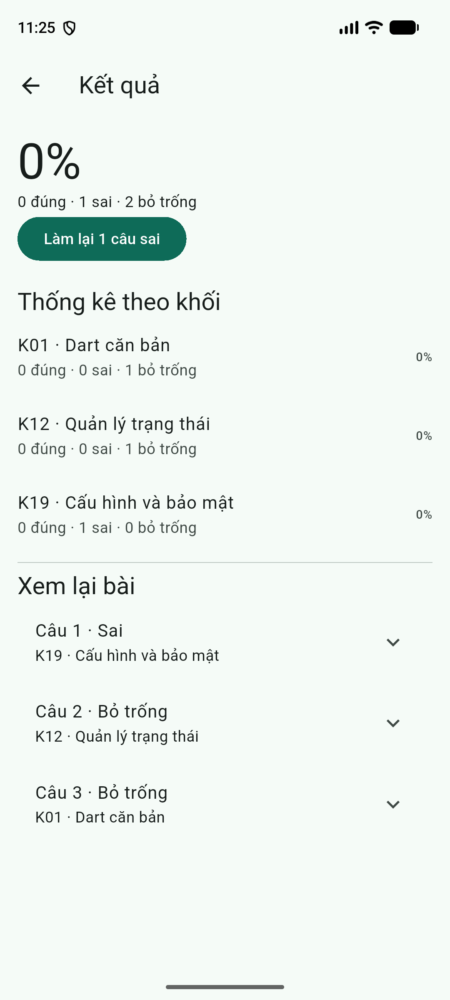

# Báo cáo công việc Đức Anh — Ngày 1

Ngày thực hiện 18/11/2026.

Theo [kế hoạch Notion](https://app.notion.com/p/41b8ae219ffa81cc9536ebc9e4b5475d), phần việc của Đức Anh gồm nạp JSON vào Flutter, kiểm tra mã câu duy nhất, dữ liệu Việt–Anh và mã đáp án hợp lệ, rồi tạo lượt luyện mẫu 3 câu có thể chọn và nộp bài.

| Yêu cầu | Công việc đã thực hiện | Kết quả |
| --- | --- | --- |
| Dùng ngân hàng 300 câu | Kiểm tra luồng đọc asset JSON đã có trong base và đối chiếu tệp asset với tệp gốc | Đủ 300 câu, 20 nhóm topic. Có 300 giá trị id duy nhất và 300 mã code duy nhất. Hai file có cùng SHA-256. |
| Nội dung song ngữ hợp lệ | Bổ sung kiểm tra chuỗi rỗng hoặc chỉ chứa khoảng trắng trong câu hỏi, giải thích và lựa chọn Việt–Anh | Tất cả 300 câu hiện tại hợp lệ. Dữ liệu thiếu nội dung bị từ chối khi nạp. |
| Mã câu và đáp án hợp lệ | Giữ cơ chế kiểm tra id duy nhất, 4 lựa chọn có mã riêng và correct_answer trỏ tới một lựa chọn | Thêm kiểm thử dữ liệu hỏng để xác nhận các trường hợp trên bị từ chối. |
| Lượt luyện 3 câu | Thêm mức 3 câu vào màn hình chọn số câu; dùng lại luồng tạo đề, trả lời và nộp của base | Có thể bắt đầu từ trang chủ, chọn phương án và nộp để xem kết quả. |
| Bản Android dùng để kiểm tra | Build APK debug, cập nhật app trên Pixel 8 | Build và cài thành công. Chạy và nghiệm thu từ giao diện Android. |

Phần đã có trong base được tái sử dụng gồm model Question, Choice, hàm decodeQuestions, createQuiz, màn hình QuizHome/QuizPage và chấm điểm QuizResult. Thay đổi lần này tập trung vào kiểm tra nội dung rỗng và thêm lựa chọn luyện 3 câu.

## Kiểm chứng

- Đối chiếu SHA-256 giữa asset và file gốc tại D:\flutter-quiz\flutter_quiz_300.json. Giá trị chung là C3BA3FDF7DEA069C86D900F3FDFDB1AEE048DB594F967A4F65173ED677048014.
- Chạy flutter analyze và xác nhận không có vấn đề.
- Cả 3 bài kiểm thử đều đạt, gồm kiểm tra ngân hàng và chấm theo ID, từ chối dữ liệu hỏng, thao tác chọn/nộp lượt 3 câu. Bộ test dùng flutter test --no-pub --no-test-assets, với widget test đọc dữ liệu trực tiếp từ file thật.
- Trên Pixel 8, mở app từ APK mới, chọn 3 câu, bắt đầu luyện, chọn một phương án ở câu đầu và nộp. Kết quả quan sát được là 0 đúng, 1 sai, 2 bỏ trống. Tổng bài và số dòng xem lại đều khớp 3 câu.

Máy ảo ban đầu có màn hình đen và công cụ đọc giao diện trả lỗi. Khởi động lại Pixel 8 với tùy chọn đồ họa swiftshader đã khôi phục màn hình để hoàn thành nghiệm thu.

## Bàn giao

- lib/main.dart có lựa chọn 3 câu.
- lib/question.dart có kiểm tra nội dung song ngữ rỗng khi nạp dữ liệu.
- test/widget_test.dart chứa các kiểm thử liên quan.
- build/app/outputs/flutter-apk/app-debug.apk là APK đã cài để nghiệm thu.

Để thử lại trong Android Studio, mở thư mục flutter-quiz-app, chạy lib/main.dart trên Android, chọn 3 câu rồi bấm Bắt đầu luyện tập. Chọn đáp án và bấm Nộp bài để xem kết quả.

Đang dùng topic để nhóm khối K01–K20 theo quy ước tạm của kế hoạch. Định nghĩa “khối” vẫn cần nhóm đối chiếu với giảng viên. Các thay đổi và báo cáo hiện nằm trong dự án cục bộ tại D:\APP-KTHP\flutter-quiz-app.
